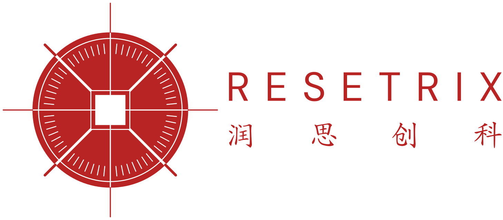

  

<em>Re-think. Re-work. Re-focus.</em>

  <a href="https://resetrix.com">Website</a> ·
  <a href="https://resetrix.com/#contact">Book a System Fit Call</a> ·
  <a href="mailto:hello@resetrix.com">Get in touch</a>

## Better operations, built around your business

Resetrix helps Singapore SMEs turn paper, spreadsheet and chat-based records into
structured data, then move their workflows onto systems that fit the way their
business works.

We are a team of workflow architects: we diagnose the problem and design the
blueprint before anything is built. We build custom software when evidence shows
a standard tool cannot carry the operation.

## What we do

- **Workflow Digitisation & Digitalisation** — turn scattered records into data
  you can trust, then improve how quotes, jobs, approvals and reporting flow
  through your operation.
- **Software Customisation & Integration** — configure, connect and extend the
  tools you already use, closing the gaps without replacing what works.
- **Operational Care** — support the systems we deliver with maintenance,
  security upkeep, adoption reviews and a planned improvement roadmap.

We work with businesses in **logistics, construction, warehousing and field
services**.

## Build less. Improve more.

Our approach starts with the least-complex change that improves a business
measure:

**Configure → Connect → Automate → Extend → Replace only when needed.**

## One partner, the right specialists

Resetrix is both a delivery company and a curated network of specialists. Our
core team diagnoses, designs and delivers work within our expertise. When a
requirement reaches beyond it, we bring in a vetted specialist and manage their
work within the same blueprint.

You keep **one point of contact**, with Resetrix accountable for quality,
security and final delivery.

---

Have an operational bottleneck worth fixing? [Book a 20-minute System Fit
Call](https://resetrix.com/#contact) or email
[hello@resetrix.com](mailto:hello@resetrix.com).
